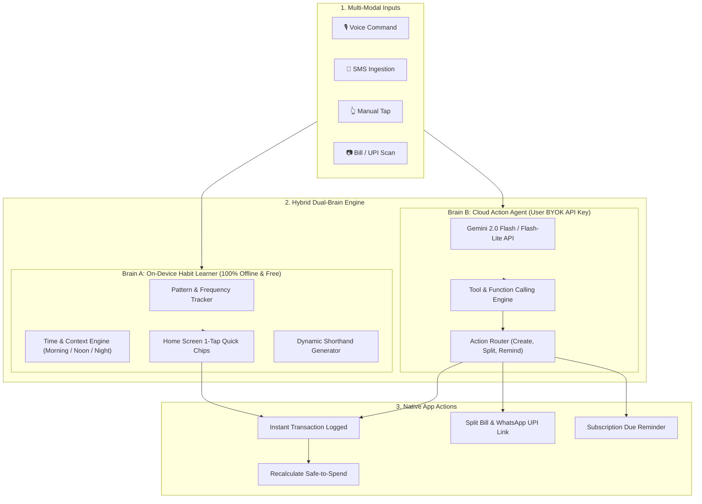

# Expensio — Plan 2: Student & Everyday Money Management Engine

> **Document:** PLAN_2.md  
> **Status:** Approved / Planned for Execution  
> **Target Audience:** Students, Flatmates, Young Professionals, and Everyday Individuals  
> **Core Philosophy:** Zero-friction, effortless money tracking with local habit learning and AI-powered action automation.

---

## 1. Vision & Core Value Proposition

Students and young adults do not fail at managing money because of complex financial math; they fail because **logging expenses feels like a chore**. If an app requires 6 taps, navigating multiple drop-downs, and manual typing after every ₹20 chai or ₹50 auto-rickshaw ride, users abandon it within 2 weeks.

**Expensio Plan 2** turns the app into an intuitive, self-learning personal finance companion that:
1. **Learns habits locally**: Automatically detects repeated spending (chai, snacks, auto, canteen) after 4–5 entries and creates 1-tap Home Screen quick-chips.
2. **Empowers actions via AI (BYOK)**: Connects to the user's free Gemini API key to understand voice/text commands and take actions directly inside the app (logging expenses, splitting bills, scheduling reminders).
3. **Closes the roommate bill-split loop**: Generates 1-tap WhatsApp settlement messages and deep-links directly into UPI apps (GPay, PhonePe, Paytm).
4. **Protects against bill anxiety**: Introduces a real-time "Safe to Spend" gauge so students never get caught off-guard by Netflix or hostel bills.

---

## 2. Architecture: Hybrid Dual-Brain AI System

---

## 3. Core Modules & Specifications

### Pillar 1: On-Device Habit & Shorthand Learner (Brain A)
- **Zero Cost, 100% Offline, Instant (<5ms)**:
  - Runs entirely on local Hive storage without sending data anywhere.
- **Pattern Recognition Trigger**:
  - Tracks frequency tuples: `(title, category, amount, timeOfDay, account)`.
  - When an expense is logged **≥ 4 times** (e.g., *"Chai ₹20"*, *"Auto ₹50"*, *"Canteen Meal ₹120"*), it is automatically promoted to an **Active Habit Chip**.
- **Context & Time-Aware Home Screen Strip**:
  - **Morning (07:00 – 11:30)**: Highlights `☕ Chai ₹20`, `🚇 Metro ₹40`, `🍳 Breakfast ₹80`.
  - **Afternoon (12:00 – 15:30)**: Highlights `🍛 Canteen Lunch ₹120`, `🥤 Juice ₹40`.
  - **Evening (16:30 – 21:00)**: Highlights `☕ Evening Chai ₹20`, `🛺 Auto ₹50`, `🍕 Snacks ₹150`.
- **1-Tap Execution with Instant Undo**:
  - Tapping a chip immediately records the transaction.
  - Displays a clean 3-second SnackBar: *"Logged Chai (₹20) · [UNDO]"*.
- **Self-Generating Shorthands**:
  - Automatically creates shorthand autofills so typing `ch` in the note or search bar immediately suggests the entire pre-filled transaction.

---

### Pillar 2: Action-Taking Cloud AI Agent (Brain B - BYOK)
- **User's Free API Key (Privacy & Free Model)**:
  - Users plug in their own free Google Gemini API key in **AI Settings** (`gemini-2.0-flash` or `gemini-2.0-flash-lite`).
  - Zero cloud hosting cost for Expensio, zero user subscription fee, zero API rate-limit bottlenecks.
- **Tool / Function Calling Engine**:
  - The AI acts as an **Action Agent**, not just a passive chatbot.
  - When the user speaks or types naturally:
    - *"Log 150 for auto from Cash and add note exam center"*  
      → Calls `createExpense(amount: 150, category: 'Transport', account: 'Cash', note: 'Exam center')`.
    - *"Split 900 dinner bill with Rahul and Sneha equally, paid from HDFC"*  
      → Calls `createSplitExpense(amount: 900, participants: ['Rahul', 'Sneha', 'Me'], method: 'Equal', account: 'HDFC')`.
    - *"Remind me about my Netflix renewal of 199 next Monday"*  
      → Calls `scheduleSubscription(name: 'Netflix', amount: 199, dueDate: '2026-11-08')`.
- **Natural Language Financial Intelligence**:
  - *"How much did I spend on food and snacks this week?"*  
    → AI queries local records and responds in 1 concise, conversational sentence.

---

### Pillar 3: Roommate & Student Bill Splitting ("Closing the Loop")
- **The Missing Link**: Currently, bill split calculators tell you who owes what, but leave the settlement hanging in limbo.
- **1-Tap WhatsApp Share Card**:
  - Generates pre-formatted WhatsApp text with one tap:
    > *"Hey! 🍕 Yesterday's dinner bill split:*  
    > *Total: ₹900 | Your share: **₹300***  
    > *Pay me via UPI: **umang@upi** or click to pay."*
- **Direct UPI Deep-Link Settlement**:
  - "Settle Up" button uses standard Android `upi://pay` intent, opening GPay, PhonePe, or Paytm with the friend's VPA and exact amount pre-populated.
- **Incoming SMS Settle Reconciliation**:
  - When an incoming bank SMS says *"Credited ₹300 via UPI from RAHUL"*, Expensio prompts:  
    *"Rahul just sent ₹300. Mark his dinner split as settled? [Yes, Settle]"*.

---

### Pillar 4: Subscription & Bill Anxiety ("Safe to Spend")
- **The Student Dilemma**: Running out of money 5 days before the month ends because an unexpected subscription or Wi-Fi bill auto-debited.
- **"Safe to Spend Today" Widget on Home**:
  $$\text{Safe to Spend} = \text{Current Bank Balance} - \sum \text{Upcoming Bills / Subscriptions Due Before Next Allowance}$$
  - Clearly shows: *"Balance: ₹4,200 | Reserved for Bills: ₹1,500 | Safe to Spend: ₹2,700 (₹180/day)"*.
- **Trial Expiry Sentinel**:
  - When logging any subscription, a 1-tap checkbox: *"Free Trial? Remind me 2 days before charge date to cancel."*

---

### Pillar 5: Frictionless Data & Media Handling
- **Smart Image Compression**:
  - Automatically compresses camera receipts from 5MB+ JPEGs to ~150KB WebP images upon capture, preserving phone storage.
- **Full-Screen Receipt Viewer**:
  - Pinch-to-zoom and shareable receipt image export.
- **Auto-Pilot SMS Rules**:
  - Allow users to set trusted auto-log rules: *"Auto-log Swiggy/Zomato/Uber under ₹400 without manual review."*

---

## 4. Implementation Roadmap

| Step | Phase | Key Tasks |
|:---:|:---|:---|
| **Step 1** | **On-Device Habit Learning Engine** | • Create `HabitLearningService` analyzing frequency of `(title, amount, category, timeOfDay)` • Create `HabitChipStrip` widget on Home Screen with 1-tap auto-log + undo SnackBar • Add Time-of-Day contextual filtering (Morning / Noon / Night) |
| **Step 2** | **Action-Taking AI Copilot (Gemini BYOK)** | • Expand `gemini_ai_model.dart` with Gemini Function Calling tools (`log_expense`, `split_bill`, `add_subscription`) • Wire `VoiceEntryScreen` and Home Smart Bar directly into the Action Agent • Natural language chat/query sheet for financial questions |
| **Step 3** | **Social Bill Splitting & UPI Deep-Link** | • Add "Share to WhatsApp" action with formatted breakdown text & UPI ID • Add `upi://pay` intent launch button in `SplitBillToolView` • Add incoming SMS credit matcher for auto-settling split debts |
| **Step 4** | **"Safe to Spend" Widget & Trial Tracker** | • Compute `Safe to Spend` in `month_budget_providers.dart` • Display dynamic Safe-to-Spend card on Home Screen • Add trial alert trigger in `recurring_subscription_model.dart` |
| **Step 5** | **Storage & Receipt Polish** | • In-app receipt compressor using image package (150KB WebP) • Full-screen interactive viewer with zoom and share |

---

## 5. Verification & Testing Checklist
- [ ] Habit engine triggers after 4 identical or near-identical logs.
- [ ] Home screen habit chips change smoothly between morning, afternoon, and evening.
- [ ] Tapping a habit chip logs immediately and undo button reverts cleanly.
- [ ] Voice command *"Log 150 for petrol from Cash"* creates the transaction via Gemini tool call.
- [ ] WhatsApp share button produces clean, readable markdown/text with UPI payment instructions.
- [ ] Settle button properly opens Android UPI intent with recipient VPA.
- [ ] Safe to Spend accurately subtracts pending subscriptions from current balance.
- [ ] `flutter analyze` passes with 0 errors.
